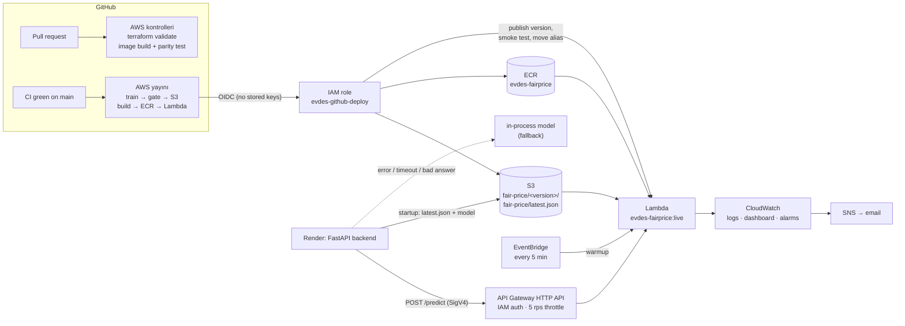

# AWS — the fair-rent model as a service

The fair-rent advisor (`/api/estimate`, and the fair-price card on every house
listing) gets its price band from a LightGBM model. This document describes the
optional AWS setup that moves that model out of the API container:

- the model is **trained in GitHub Actions**, checked by a **quality gate** and
  stored **versioned in S3**;
- predictions are served by an **AWS Lambda** function behind **API Gateway**;
- the Render backend calls it, and **falls back to the in-process model** on any
  error, timeout or bad answer — the site never depends on AWS being up.

Everything is in code: infrastructure in [`infra/`](../infra) (Terraform), the
service in [`services/fairprice/`](../services/fairprice), the pipeline in
[`aws-checks.yml`](../.github/workflows/aws-checks.yml) and
[`aws-deploy.yml`](../.github/workflows/aws-deploy.yml).

Until the AWS account is set up (section 6), none of this runs: the deploy
workflow skips itself and the backend serves the model baked into its image,
exactly as before.

---

## 1. Architecture



| Piece | What it is | Where |
|---|---|---|
| Model bucket | S3, versioned, private, TLS-only. One immutable folder per trained model plus a `latest.json` pointer. | `infra/storage.tf` |
| Image registry | ECR, immutable tags, scan on push, keeps the last 10 images. | `infra/service.tf` |
| Prediction service | Lambda (container image, 1 GB, 10 s), a `live` alias, warmed every 5 minutes. | `infra/modules/predict-service/lambda.tf`, `services/fairprice/` |
| HTTP front door | API Gateway HTTP API, `POST /predict`, **IAM authorization**, throttled. | `infra/modules/predict-service/api.tf` |
| CI identity | GitHub OIDC provider + a role only `main` of this repository can assume. | `infra/github.tf` |
| Backend identity | IAM user for Render: read models, call `/predict`. Nothing else. | `infra/render.tf` |
| Observability | Dashboard, two alarms, email via SNS, a $5 monthly budget. | `infra/monitoring.tf`, `infra/modules/predict-service/monitoring.tf` |

The region is `us-west-2` (Oregon): Render's blueprint lands there, so a
prediction request never leaves the region.

## 2. Request path

`app/rent_model.py` decides who computes the band:

1. If `FAIRPRICE_URL` and the AWS keys are set, the backend signs a request with
   **SigV4** (botocore) and posts the raw listing fields to `/predict`:
   `{"rows": [{"room", "living_room", "area", "age", "floor", "district", "neighborhood"}]}`.
   The contract is the raw fields, **not** the feature matrix: both sides build
   features with the same `app/pricing.py`, so the service can never receive a
   matrix that does not match its model.
2. The Lambda answers the **raw flat-rent band** (training-period lira). CPI
   indexing and the per-room split stay in the backend, so product rules can
   change without redeploying the service.
3. The backend validates the answer (row count, `0 < low ≤ mid ≤ high`). Any
   failure — timeout (3 s), 4xx/5xx, malformed body — and the band is computed
   by the in-process model instead. The user sees the same answer either way.
4. **Circuit breaker:** after 2 consecutive failures the service is not tried
   for 60 s, so an AWS outage does not add a timeout to every request. One
   failure (a cold start) does not open it.

Both responses carry `served_by: "lambda" | "local"`, and `/api/health` shows the
state without affecting the health verdict:

```json
"fair_price": {"model_source": "s3", "model_version": "20261026-193000-a1b2c3d", "lambda": "on"}
```

`lambda` is `off` (not configured), `on`, or `fallback` (breaker open).

**Cold starts.** Importing pandas/scikit-learn/LightGBM and fetching the model
takes a few seconds (measured ~5 s on the first call in the CI emulator, warm
calls ~15–30 ms for 1–50 rows). The model is loaded in the Lambda init phase,
and an EventBridge rule sends `{"warmup": true}` every 5 minutes so one
environment stays warm at this traffic level. A request that still lands on a
cold environment falls back to the local model while the Lambda warms up.

## 3. Model lifecycle

```
train_model.py ──► models/fair_price_model.joblib + models/metrics.json
publish_model.py ─► s3://evdes-models-<account>/fair-price/<version>/   (always)
                 └► fair-price/latest.json                              (only if the gate passes)
```

- **`metrics.json`** records what was trained: the hold-out median error of the
  served q50 model, the **coverage** of the q25–q75 band on held-out listings,
  row/district/neighbourhood counts, git commit, library versions, the file's
  sha256 and the feature signature.
- **Quality gate** (`scripts/publish_model.py`): the candidate is rejected if
  its median error is more than 0.5 points worse than the live model's, if band
  coverage is outside 30–70% (today ~40%; a collapsed or exploded band would
  slip past a q50-only check), or if the data has fewer than 5,000 rows. A
  rejected candidate is still uploaded to its own folder so it can be inspected;
  `latest.json` does not move and the workflow goes red.
- **Version folders are immutable.** A second upload under the same version is
  refused, so whatever a Lambda version pinned is still there byte-for-byte.
- **Training/serving skew guard.** `pricing.feature_signature()` hashes
  `app/pricing.py` and the installed LightGBM/scikit-learn/pandas/numpy
  versions. Training stores it in the model; the backend and the Lambda refuse
  a model whose signature differs from their own code. If someone changes
  feature engineering, the old model in S3 is ignored (backend uses the image
  model) or the new Lambda version fails its smoke test (alias stays put) until
  a retrained model passes the gate.
- **Integrity.** The backend checks the downloaded bytes against the sha256 in
  `latest.json`; the Lambda checks them against the sha256 **baked into its
  image** at build time (`MODEL_SHA256`). Loading a joblib file executes code,
  so only verified files from a bucket that only the CI role can write are
  loaded.

The Lambda image pins `MODEL_VERSION` at build time. A Lambda version therefore
always serves the same model, and rolling back the alias rolls back code and
model together.

## 4. Deployment pipeline

**On pull requests** (`aws-checks.yml`, no AWS account needed, only when
`infra/`, `services/fairprice/` or the model code changes):

- `terraform fmt -check` and `terraform validate`;
- service unit tests, including one that fails if the Lambda's pinned library
  versions drift from `backend/requirements.txt`;
- trains the model, builds the Lambda image, runs it under the **Lambda Runtime
  Interface Emulator** and checks that 200 random listings get **exactly** the
  same band from the image as from the backend's local code (relative
  difference 0), then runs the deploy smoke test against it.

**On `main`** (`aws-deploy.yml`, after CI is green):

1. *plan* — looks at the merged files: model code/data → train; service code →
   deploy. Manual runs choose with two checkboxes.
2. *train* — trains, then `publish_model.py` uploads and gates.
3. *deploy* — builds the image with the live model pinned, pushes it to ECR
   (new immutable tag per run), `update-function-code`, **publishes a new
   version**, invokes *that version* with `smoke-event.json`
   (`smoke_check.py`: status 200, the expected model version, plausible bands),
   and only then points `live` at it. If the smoke test fails, traffic stays on
   the previous version and the job is red.

The job summary prints the previous version and the one-line rollback:

```bash
aws lambda update-alias --function-name evdes-fairprice --name live --function-version <previous>
```

Terraform owns the function and the alias but ignores the image and the alias
target after the first apply; GitHub Actions owns deployments. A published
version freezes its configuration, so after changing e.g. memory in Terraform,
run *AWS yayını* manually to publish a version that carries it.

## 5. Security

- **No AWS keys in GitHub.** Workflows get a one-hour role via OIDC. The trust
  policy only accepts tokens for `repo:bariskiratt/istanbul-roommate-platform:ref:refs/heads/main`,
  so pull requests (including forks) cannot reach AWS.
- **Least privilege.**

  | Identity | Can | Cannot |
  |---|---|---|
  | `evdes-github-deploy` (CI) | read/write `fair-price/*` in the model bucket, push to the one ECR repo, update/publish/invoke/alias the one function | touch IAM, networking, other buckets, delete anything |
  | `evdes-fairprice-lambda` | read `fair-price/*`, write its own log group | everything else |
  | `evdes-render-backend` (Render) | read `fair-price/*`, call `POST /predict` | write anything |

- **The only long-lived key** belongs to the Render user (Render has no OIDC).
  It is created by hand, never by Terraform, so it is not in the state file.
- **The API is not public.** The route requires IAM authorization; an unsigned
  request gets 403 from API Gateway and never reaches the Lambda. Throttling
  (5 rps, burst 10) and the $5 budget alarm bound the cost of a leaked key.
- The model bucket blocks public access, enforces TLS, and is versioned; ECR
  tags are immutable and images are scanned on push.

## 6. One-time setup

You need an AWS account, the AWS CLI v2 and Terraform ≥ 1.10. Steps 1–3 are
in the console; never create access keys for the root user.

1. **Account.** Create the account, enable MFA on the root user, then create a
   day-to-day admin user in **IAM Identity Center** (with MFA) and sign in with
   it from the CLI: `aws configure sso`, then `export AWS_PROFILE=<profile>`.
   `aws sts get-caller-identity` must show that user, not root.
2. **State bucket + init.** `cd infra && ./bootstrap.sh`. It creates
   `evdes-tfstate-<account>` (versioned, private), copies
   `terraform.tfvars.example` to `terraform.tfvars` and runs `terraform init`.
   Put your address in `alert_email` in `terraform.tfvars` (that file is
   git-ignored; the repository is public).
3. **First apply.** `terraform apply`. It creates the model bucket, ECR, the
   GitHub role, the Render user, the alert topic and the budget. Confirm the
   subscription email AWS sends you, or alarms will not arrive.
4. **Connect GitHub.** Repository → Settings → Secrets and variables → Actions →
   **Variables** → `AWS_ROLE_ARN` = the `github_role_arn` output. It is a
   variable, not a secret: the ARN is not sensitive.
5. **First model and image.** Actions → **AWS yayını** → Run workflow on `main`
   with both boxes ticked. It trains, uploads and promotes the first model,
   builds the image and pushes it to ECR, then notes that the function does
   not exist yet.
6. **Second apply.** Set `enable_predict_service = true` in
   `terraform.tfvars` and run `terraform apply` again. It creates the Lambda
   from the image just pushed, the alias, API Gateway, the warmer, the alarms
   and the dashboard. Outputs: `predict_url`, `dashboard_url`.
7. **Render key.** `aws iam create-access-key --user-name evdes-render-backend`.
   The secret is shown once; paste it straight into Render, do not store it
   elsewhere.
8. **Render environment** (roommatch-api → Environment), then save to redeploy:

   | Variable | Value |
   |---|---|
   | `FAIRPRICE_MODEL_BUCKET` | `model_bucket` output |
   | `FAIRPRICE_URL` | `predict_url` output |
   | `FAIRPRICE_AWS_ACCESS_KEY_ID` | from step 7 |
   | `FAIRPRICE_AWS_SECRET_ACCESS_KEY` | from step 7 |

9. **Verify.** `https://api.evdes.tr/api/health` shows
   `"fair_price": {"model_source": "s3", "model_version": "…", "lambda": "on"}`;
   a fair-price card on a listing returns `"served_by": "lambda"` (browser dev
   tools → Network); the dashboard shows the request.

**Turning it off:** delete `FAIRPRICE_URL` in Render (estimates go local at
once) or both variables (the image model is used). **Removing everything:**
`terraform destroy`, then delete the state bucket by hand.
**Rotating the Render key:** create a second key, update Render, then
`aws iam delete-access-key --user-name evdes-render-backend --access-key-id <old>`.

## 7. Cost

At this traffic it stays within the free allowances; the budget alarm emails at
80% of $5 actual or 100% forecast.

| Item | Usage | Price after free allowance |
|---|---|---|
| Lambda | warmer 8,640 calls/month + real traffic, ~20 ms at 1 GB | free tier: 1M requests and 400,000 GB-s per month |
| API Gateway HTTP API | real traffic only | $1.00 per million requests |
| S3 | a few 6 MB models | ~$0.023 per GB-month |
| ECR | ≤ 10 images sharing layers (~250 MB compressed each) | $0.10 per GB-month |
| CloudWatch | logs (30-day retention), 1 dashboard, 2 alarms | 3 dashboards and 10 alarms free |

## 8. Measuring (for the CV)

The dashboard (`dashboard_url` output) holds every number worth quoting:

- **Requests and predictions per day, p50/p95 handler time** — Logs Insights
  over the Lambda's `{"event": "predict"}` lines (warmups excluded).
- **Cold starts and init time** — the `REPORT` lines' `@initDuration`.
- **End-to-end latency p50/p95** — API Gateway `Latency` / `IntegrationLatency`.
- **Fallback rate** — Render logs print a line per failed call
  (`Lambda tahmin servisi: …; yerel model.`); compare with API Gateway `Count`.

Not yet measurable: build time. The backend image still trains its own copy of
the model as the fallback. Once S3 has served models reliably, removing the
`train_model` line from `backend/Dockerfile` makes the S3 model the only one
and shortens every Render build; measure the build log before and after.

## 9. Working locally

```bash
# Lambda image + parity test without AWS (what aws-checks.yml does)
cd backend && python -m scripts.train_model --fast && cd ..
docker build --provenance=false -f services/fairprice/Dockerfile -t fairprice:dev .
docker run -d --name fairprice -p 9000:8080 -e MODEL_PATH=/opt/model/fair_price_model.joblib \
  -v "$PWD/backend/models:/opt/model:ro" fairprice:dev
python services/fairprice/parity_check.py --model backend/models/fair_price_model.joblib \
  --endpoint http://localhost:9000/2015-03-31/functions/function/invocations

# Tests
cd backend && python -m pytest -q            # includes rent_model / publish_model
cd .. && python -m pytest -q services/fairprice/tests
```

The backend reads the `FAIRPRICE_*` variables from the environment; leave them
unset locally and it behaves exactly as without AWS.
